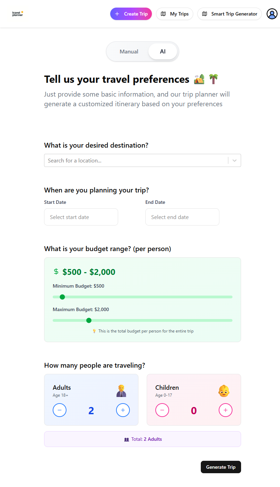
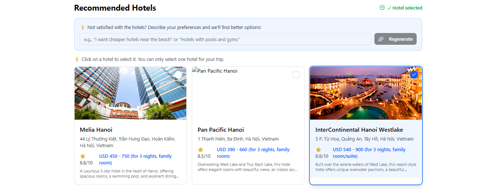
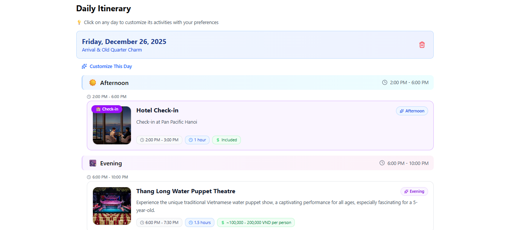
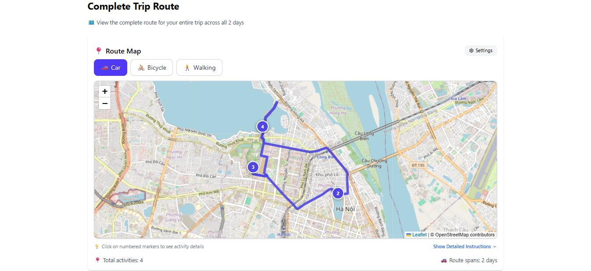
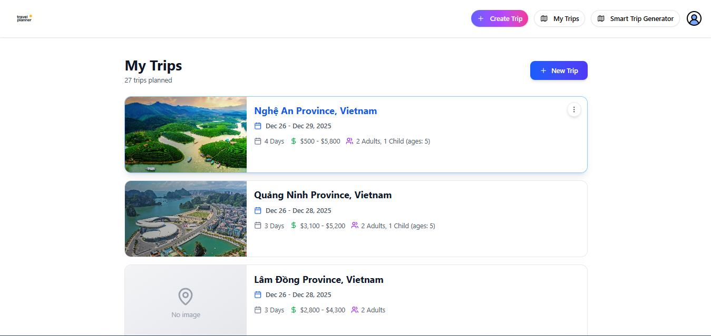
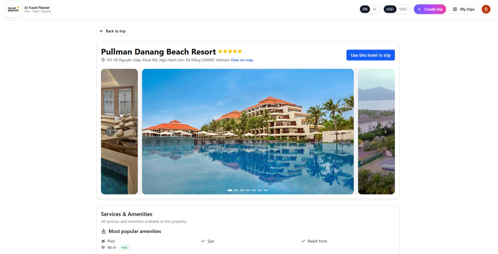
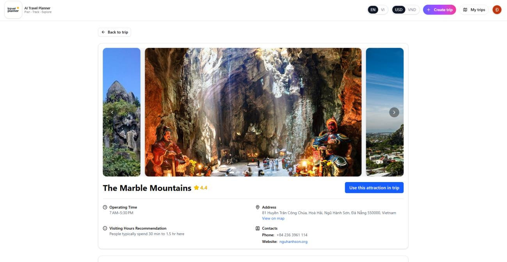
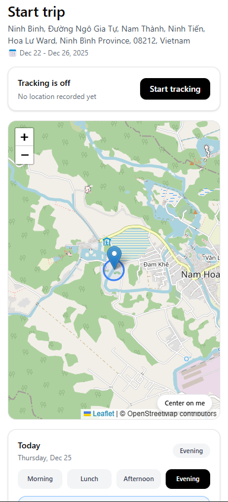
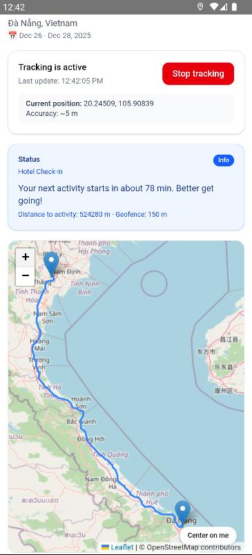

# AI Travel Planner

AI Travel Planner is a web and mobile application for building day-by-day travel itineraries across Vietnam and tracking trips in real time. Users can generate schedules automatically with AI, build them from curated local datasets, or plan trips manually from scratch.

## Key Features

- **Flexible Trip Planning**: Generate full itineraries with Google Gemini, use **Smart Trip** mode to build plans strictly from verified provincial hotels, restaurants, and attractions in the database, or create and reorder schedules manually via drag-and-drop.
- **Hotel & Attraction Discovery**: View hotel room rates, amenities, policies, attraction opening hours, ticket info, and reviews powered by Google Hotels and Google Maps (via SerpApi).
- **Interactive Route Maps**: Visualize daily routes and travel times between stops for driving, cycling, or walking using Leaflet, OSRM, and OpenRouteService.
- **Real-Time Mobile Tracking**: Follow the itinerary on Android with live GPS tracking, arrival detection (early, on-time, or late), and local push notifications before upcoming activities.
- **Admin Dataset Management**: Built-in dashboard for managing provincial data (hotels, places, and restaurants).
- **Bilingual Support**: Available in English and Vietnamese.

## Screenshots

### 1. Trip Preferences (AI & Manual Planning)


### 2. Generated Itinerary & Multi-Modal Route Map




### 3. Saved Trips (`My Trips`)


### 4. Hotel & Attraction Details



### 5. Real-Time Trip Tracking on Android
<p>
  
  
</p>

## Tech Stack

- **Frontend**: React 19, Vite, Tailwind CSS, Leaflet, `@dnd-kit`, `i18next`
- **Mobile**: Capacitor 7 (Android, Geolocation, Local Notifications)
- **Backend**: Node.js, Express 5, JWT & Google OAuth 2.0
- **Database**: Firebase Cloud Firestore
- **APIs**: Google Gemini API, SerpApi, OpenStreetMap (Nominatim, OSRM, OpenRouteService)

## Getting Started

1. **Backend**
   ```bash
   cd be
   npm install
   # Configure be/.env (Firebase Admin, Gemini API, SerpApi, JWT secret)
   npm run dev
   ```

2. **Frontend**
   ```bash
   cd fe
   npm install
   # Configure fe/.env (API URL, Firebase Web config, Google OAuth, Gemini API)
   npm run dev
   ```

3. **Android App (Optional)**
   ```bash
   cd fe
   npm run android:sync
   npm run android:open
   ```
